# Nest

**一台组装起来的虚拟主机。** 把各世代主机的照片、游戏库、模拟器、存档和手柄收进一个 Electron 外壳，
交互按“开一台主机”的逻辑走，而不是按“打开一个文件”的逻辑走。

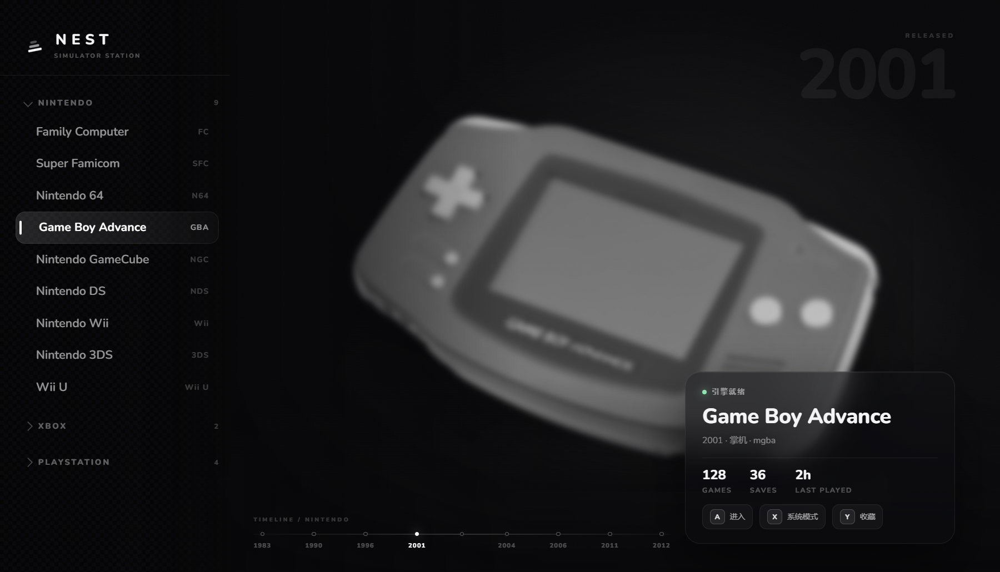

> 当前：**0.4.2-beta.1** —— Windows 桌面版 · 九台任天堂主机 + PS1/PS2/PSP 接入（PS3 界面就绪）+ Xbox / Xbox 360 主机墙 · 十个内置引擎 + 自写 libretro 宿主 · 免安装携带版

## 下载

直接下免安装版，解压双击即可用，不需要安装 Node 或任何依赖：

**[Nest-0.4.2-beta.1-portable.zip](https://github.com/Parmetty/NEST-Emulator-Station/releases/download/v0.4.2-beta.1/Nest-0.4.2-beta.1-portable.zip)** · 328.5 MB · [Release 页面](https://github.com/Parmetty/NEST-Emulator-Station/releases/tag/v0.4.2-beta.1)

```
SHA256  A447EE2EF2581A7492FD61FB51DE11D4B1E8915CF00167EC7F80261C1B2D6402
解压    807.1 MB / 3597 个文件
```

1. 解压到任意目录（可放 U 盘）
2. 双击 **`Nest.exe`** 即可（数据在 `%APPDATA%\Nest`）；想让库/封面/日志/引擎配置留在解压目录，就双击 **`启动 Nest.bat`**（便携数据模式，备用入口）
3. 点「扫描文件夹」指向你的 ROM 目录（之后每次启动会自动重扫）
4. 固件在 **设置 → Nintendo →「系统文件（自备）」** 导入

> 无数字签名，首次运行 Windows 可能提示 SmartScreen：选「更多信息 → 仍要运行」。

## 现在能做什么

| 主机 | 引擎（内置） | 直读 | 系统菜单 |
|---|---|---|---|
| GBA | mGBA 0.10.5 | ✅ | — |
| FC | ares v148 | ✅ | — |
| SFC | ares v148 | ✅ | — |
| N64 | ares v148 | ✅ | — |
| NDS / DSi | melonDS（master CI 构建） | ✅ | ✅ DS 菜单与 DSi Menu（命令行 `-b always`，无 UIA；DSi 需 DSi 固件 + 带 footer 的 NAND） |
| NGC | Dolphin 2609a | ✅ | ✅ GameCube Menu（需 IPL，Qt+UIA） |
| Wii | Dolphin 2609a / libretro 宿主 | 🟡 代码就绪，待镜像验证 | ✅ Wii Menu（WAD，经 libretro 宿主，无 UIA） |
| 3DS | Azahar 2126.2 | ✅ | 🟡 **实验性** HOME Menu（需 Azahar 系统文件，已恢复入口） |
| Wii U | Cemu 2.6 | ✅ `.wua/.wud/.wux` | ⚠️ **实验性** Wii U Menu（Cemu 2.6 限制，见下方已知限制） |
| PS1 | SwanStation（libretro） | ✅ | ⚠️ BIOS 菜单入口保留但标记「故障」（输入无响应） |
| PS2 | PCSX2 2.8.2 | ✅ | ✅ PS2 浏览器（`-bios`，需 BIOS） |
| PSP | PPSSPP master | ✅ | ✅ PSP XMB（`--vsh`，需自备 flash0 固件；可直接导入目录或用内置入口安装） |
| PS3 | RPCS3（后置） | ✖ | ❌ 无 XMB（RPCS3 尚未合并 XMB PR） |
| Xbox | xemu（待接入 P7.1） | ✖ | —（可选 Dashboard，需 HDD） |
| Xbox 360 | Xenia Canary | ✅（GOD 实测） | ❌ 无 Dashboard / 系统菜单 |

其它能力：

- **主机墙**：9 台任天堂 + 4 台 PlayStation（PS1/PS2/PSP 已接入，PS3 预留）+ 2 台 Xbox（主机墙已加入，xemu/Xenia 引擎接入中）按发售年份排列，全屏照片 + 树状列表 + 信息卡；平台切换时年代标尺跟着换
- **游戏库 + 自动扫描**：添加过的文件夹会在启动时自动重扫，新 ROM 自动出现；支持 `.cia` 与磁盘头 magic 判定 GC/Wii
- **自动封面**：游戏运行期间由独立抓屏工具持续取帧，退出时存为封面（NDS/3DS 只截上屏）
- **游戏右键重命名**：只改 Nest 库里的显示名，不改磁盘文件名；GOD 游戏的 `4D530AA4` 这类占位标题也可以手动改掉
- **自写 libretro 宿主**：`resources/tools/nest-libretro.exe`（约 90 KB，C# + SDL3）托管官方 `dolphin_libretro.dll`，**Wii 系统菜单不再依赖 Dolphin Qt GUI 自动化**，直接加载 `wii-menu.wad` 进菜单；键盘 + 鼠标绝对指针（鼠标即 Wiimote 光标，左键 = A）
- **键位面板**：mGBA / ares / Dolphin / Azahar / melonDS / Cemu / SwanStation / PCSX2 / PPSSPP / Xenia 十引擎键盘绑定可在 Nest 里改，保存立即生效；首次启动自动写默认布局，不覆盖你已有的自定义
- **设置分类**：设置窗口拆成 **Nest / Nintendo / Xbox / PlayStation** 四页；PlayStation 页含 PS1 BIOS、PS2 BIOS、PSP flash0 导入与 PS1/PS2/PSP 键位
- **NDS 系统菜单插卡**：进 DS/DSi 菜单时自动插入最近玩的 NDS 游戏（设置 → Nintendo 可关）
- **GBA 金手指**：游戏右键「金手指…」编辑 mGBA `.cheats`，保存后启动自动生效（见 [CHEATS-GBA.md](docs/nintendo/CHEATS-GBA.md)）
- **固件中心**：GameCube IPL（CRC32 白名单）、Wii 系统菜单 WAD、NDS BIOS+固件、**DSi BIOS+固件+NAND**、**Cemu keys.txt / Wii U NAND（MLC）**，一键导入（MLC 只记路径，不复制）
- **便携模式**：库、封面、日志、引擎配置都留在程序目录，删 `data\` 即恢复出厂
- **运行中高亮 / 进入前确认 / 右键移除**（只删库记录，绝不动磁盘上的 ROM）

### 键位

| 主机族 | 默认键盘布局 |
|---|---|
| GBA / NDS / 3DS | 方向键 = 十字键，Space = A，J = B，Q/E = L/R，Enter = Start，Backspace = Select |
| FC / SFC / N64 | W/S/A/D = 十字键，J/K = A/B，U/I = X/Y（SFC），Q/E = L/R，Enter = Start，右 Shift = Select |
| NGC / Wii 直读 | Dolphin GCPad 键盘布局 |
| PS1 / PS2 / PSP | 方向键 + J/K/U/I + Q/E + Enter/Backspace（写入引擎自己的配置） |
| Xbox 360 | 方向键 + J/K/U/I + Q/E + Enter/Backspace（Xenia `[HID.Key]`） |
| Wii 系统菜单 | 键盘 + 鼠标：鼠标即 Wiimote 光标（绝对定位，需 Cemu 无），左键 = A |

细节见 [KEYS-GBA.md](docs/nintendo/KEYS-GBA.md)、[KEYS-DOLPHIN.md](docs/nintendo/KEYS-DOLPHIN.md)、
[KEYS-3DS.md](docs/nintendo/KEYS-3DS.md)、[KEYS-ARES.md](docs/nintendo/KEYS-ARES.md)、[KEYS-CEMU.md](docs/nintendo/KEYS-CEMU.md)。

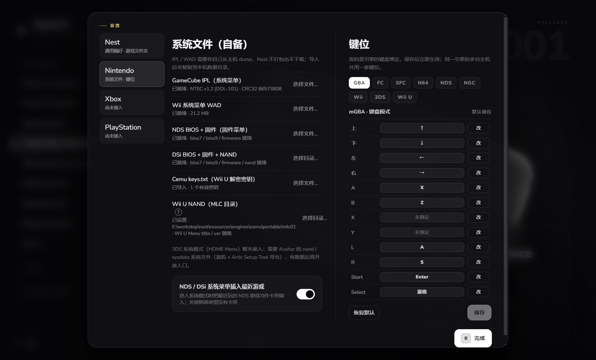

## 截图

| 游戏库 | 3DS 游戏库 |
|---|---|
| 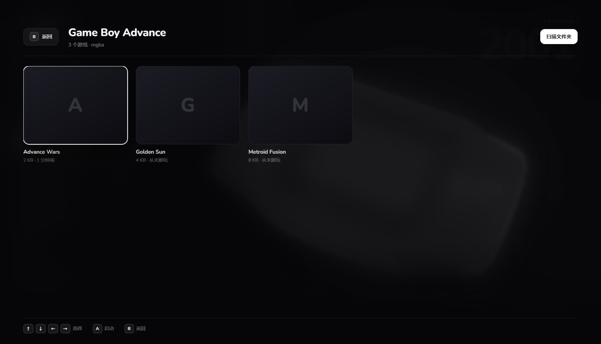 | 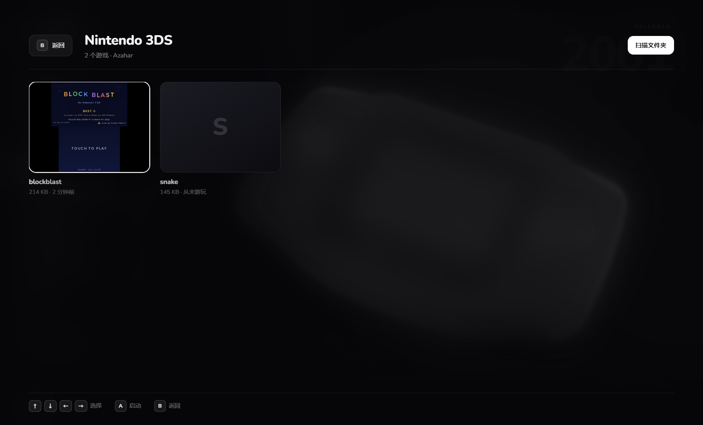 |

| Nintendo 设置 | NDS / DSi 菜单 |
|---|---|
|  | 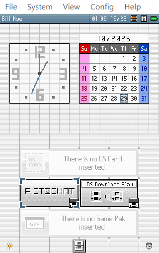 |

| 金手指入口 | 金手指编辑 |
|---|---|
| 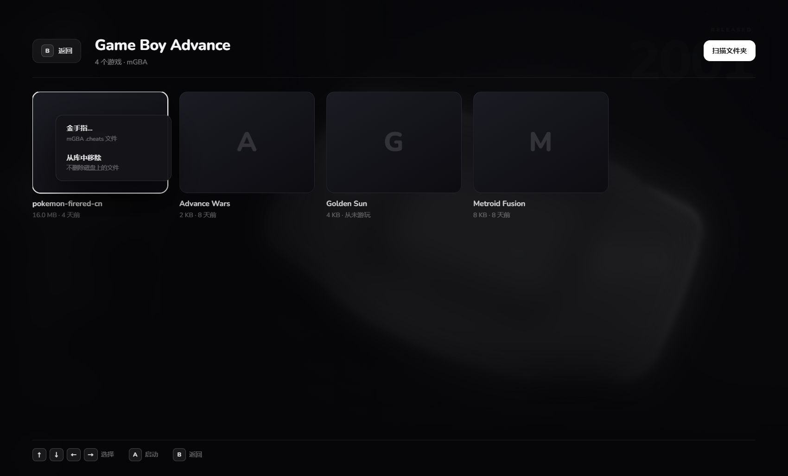 | 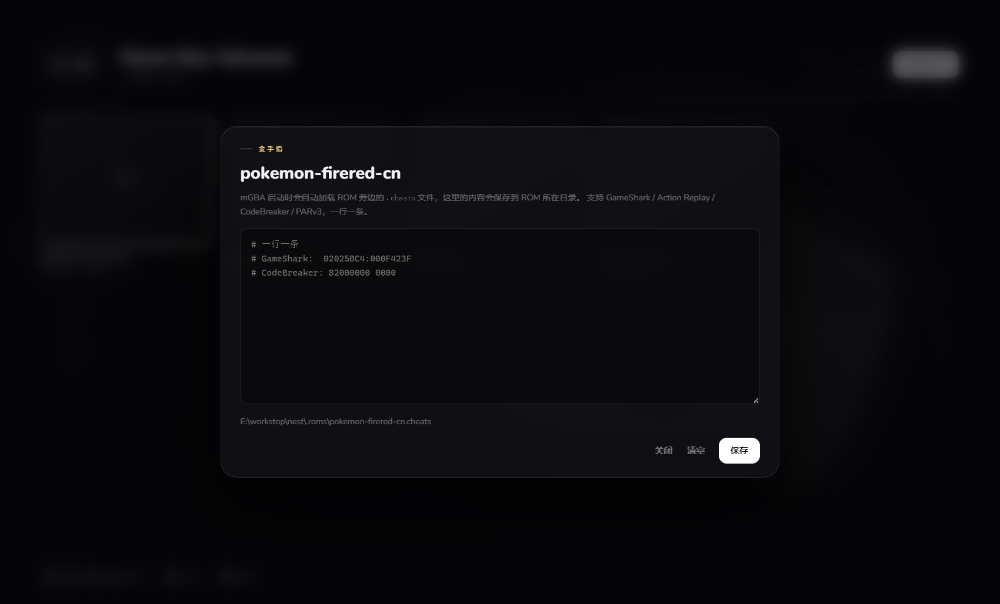 |

| PlayStation 主机墙 | PlayStation 设置 |
|---|---|
| 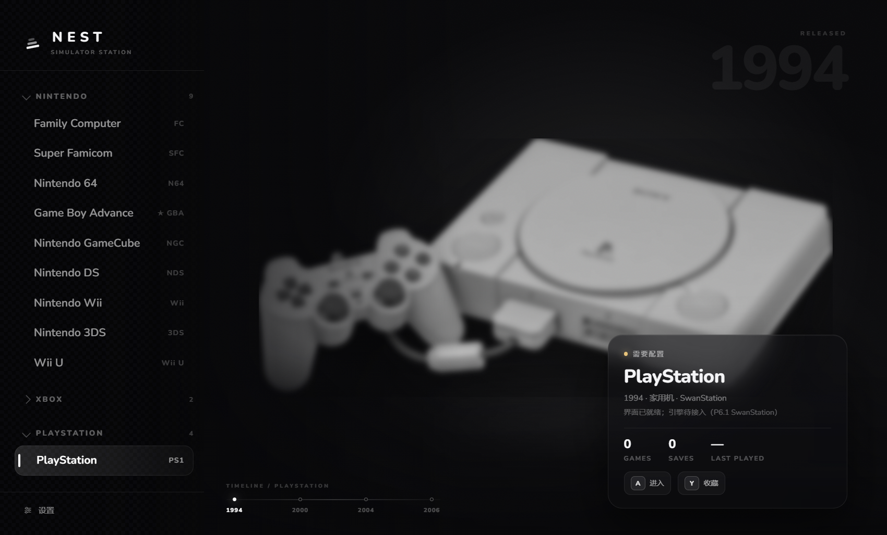 | 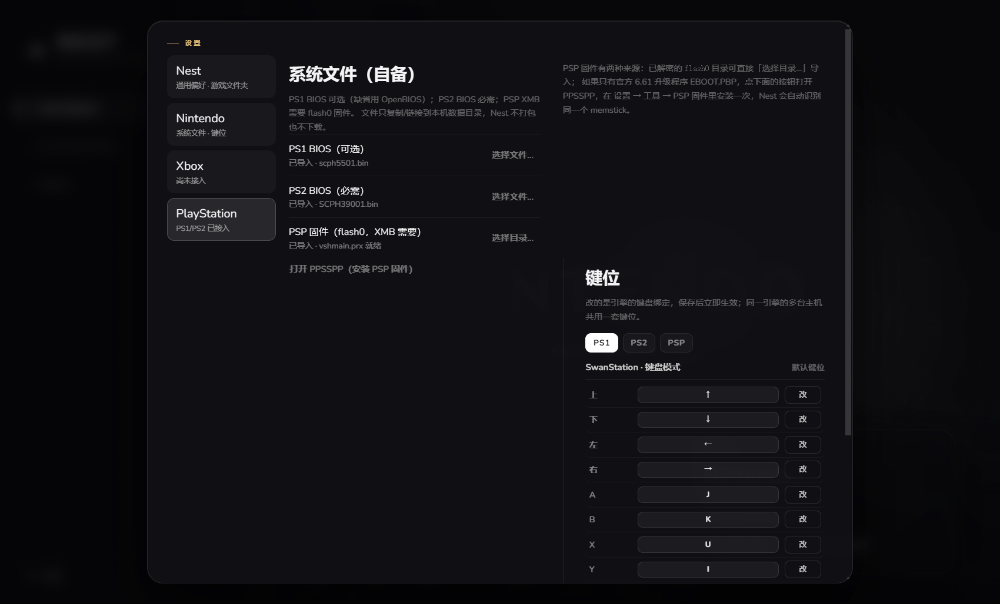 |

| Xbox 主机墙 | Xbox 360 主机墙 |
|---|---|
| 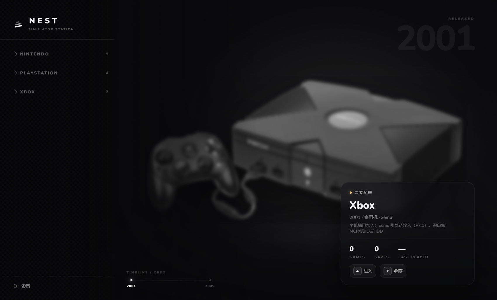 | 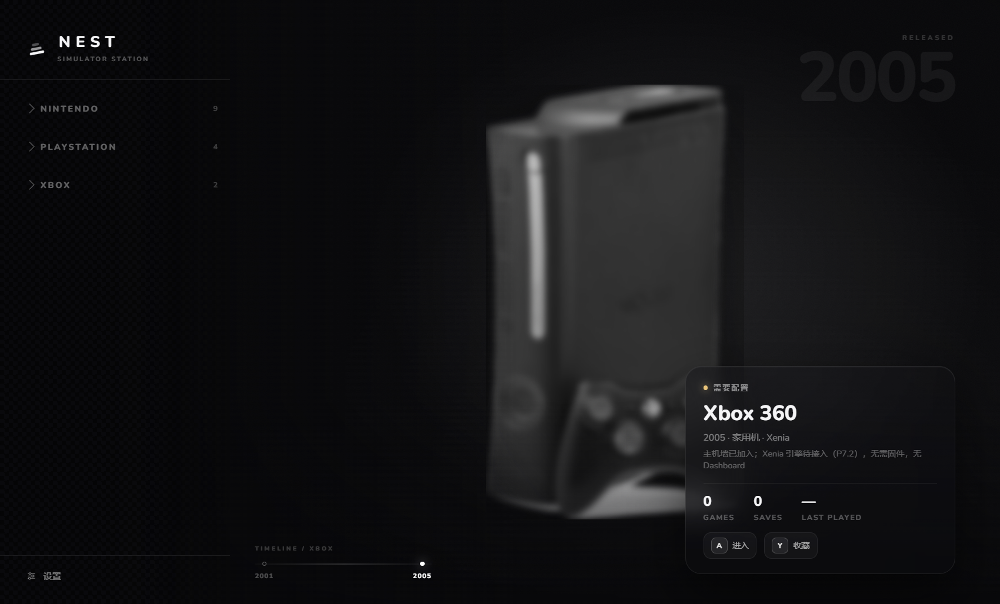 |

## 从源码运行

需要 Windows 10/11 + Node.js 20+。

```bash
npm install
npm run build
npm run start          # 或双击 Nest.bat（自动构建 + 工作区数据目录）
```

`Nest-check.bat` 会依次跑：类型检查 → 单元测试 → 构建 → 窗口冒烟。

### 打便携包

```bash
npm run pack:dir       # dist/win-unpacked（免安装目录）
npm run pack           # 免安装目录 + NSIS 安装包（默认不用，见 DECISIONS D20）
```

打包前会自动执行 `tools/clean-engines.mjs`，清掉引擎配置里的本地路径与运行时状态。

## 测试

```bash
npm run typecheck
npm test               # 100 个用例：扫描/去重/清单/keymap/引擎配置写入/DSi 配置/Wii U 导入/GBA 金手指/NDS 插卡/进程生命周期
npm run build
npm run smoke          # 窗口 + IPC + 渲染自检
```

## 架构

```
src/
  shared/            纯数据与契约（主机表、zod schema、IPC 通道名）
  main/              主进程：窗口、IPC、库、引擎清单、进程监管、扫描器
  main/controls/     各引擎的键盘绑定适配器（keymap + mgba/ares/dolphin/azahar/melonds/cemu/xenia）
  main/cemu.ts       Cemu keys.txt 导入、MLC 校验、启动参数组装
  main/melonds-config.ts  melonDS TOML 管理（NDS / DSi 切换，纯函数）
main/cheats.ts        GBA 金手指文件（mGBA .cheats 读写、回退、启动参数）
main/nds-cart.ts      NDS 系统菜单插卡选择（显式 ROM / 最近游戏 / 开关）
  preload/           contextBridge 暴露的 window.nest
  renderer/          React：首页 + 游戏库覆盖层 + 设置面板
resources/engines/   十个便携引擎 + 清单（加主机 = 加一份 JSON）
resources/tools/     nest-capture / nest-input / nest-window / nest-menu / nest-pads / **nest-libretro**
tools/               C# 助手源码（capture/input/window/menu/pads）、libretro 宿主（C#）、Wii U 安装工具、打包清理脚本、运行器
docs/                nintendo/（任天堂系：HISTORY / CHANGELOG / STATE / DECISIONS / PROGRESS / KEYS-*）
                     playstation/（PS 家族计划）· ROADMAP.md（总路线）
```

设计约定：

- **引擎是数据**：`resources/engines/<id>.json` 描述路径、参数、能力，加主机不改代码
- **进程外运行**：模拟器永远是子进程，崩溃不拖死 UI，退出有精确事件
- **IPC 全量校验**：渲染进程只拿到 `window.nest`，所有入参过 zod
- **不内置版权物**：没有 ROM / BIOS / NAND / 密钥

## 数据与隐私

数据目录默认 `%APPDATA%\Nest`；用启动脚本时改为程序目录下 `data\`：

```
library.json     游戏库、主机状态、设置
settings.controls  键位覆盖（每引擎）
scanRoots         自动扫描的文件夹列表
covers/           自动封面
shots/            抓屏中间帧（退出后清理）
nest.log          主进程日志
dolphin/          GC IPL、Wii 菜单 WAD、NAND
melonds/          NDS BIOS
azahar/           3DS 配置与 NAND
libretro/         自写宿主运行时目录（sys/save/日志）
cemu/             keys.txt、MLC 路径记录
```

没有遥测，除引擎官网外不联网。

## 已知限制

- **封面可能截到黑帧**：目前取退出前最后一帧；全黑过场的游戏可能拿到黑封面（COV-2，已评审待实现）
- **Wii 直读**代码就绪但尚无真实镜像验证
- **Wii U Menu 为实验性**：Cemu 2.6 尚未实现 `nn_act.LoadConsoleAccount`，即使 MLC 正确，菜单目前只会停在背景画面；游戏直读不受影响。设置里的 MLC 行有 ? 提示说明两条获取路径（真机 dump / CDN 手工拼装）
- **Wii 鼠标映射**：按屏幕录像标定（X 只覆盖过窗口宽度约 6%，左右两端可能还需微调）
- **3DS 无系统菜单**（Azahar 不支持 HOME Menu）
- **NGC 系统菜单**为 GUI 自动化（`File → Boot firmware` 类似路径），需要有效 IPL，Qt 菜单展开瞬间会短暂影响输入
- **没有数字签名**：首次运行 SmartScreen 提示；个别环境需 `--no-sandbox`（启动脚本已带）
- **Dolphin 键位面板**只覆盖 GCPad 主键位，select/Z/C-Stick 等扩展动作暂未映射

## 路线图

| 阶段 | 内容 | 状态 |
| --- | --- | --- |
| P0–P2 | 骨架、IPC、引擎清单、扫描器、GBA/FC/SFC/N64 闭环 | ✅ |
| P3 | Dolphin（NGC/Wii 直读 + 系统菜单）、3DS（Azahar）、NDS（melonDS） | ✅ |
| P3.5 | 自写 libretro 宿主，Wii 系统菜单去 UIA | ✅ |
| P4 | Wii U（Cemu 2.6 + keys/MLC 导入） | 引擎完成，系统菜单实验性 |
| P5 | 封面质量、Cemu 键位适配、自动构建脚本、安装包（按需） | 进行中 |

总路线见 [ROADMAP.md](docs/ROADMAP.md)；发布级变化见 [CHANGELOG.md](docs/nintendo/CHANGELOG.md)，现状见 [STATE.md](docs/nintendo/STATE.md)，逐日进展见 [PROGRESS.md](docs/nintendo/PROGRESS.md)。功能编年史为内部文档，不随仓库发布。

## 法律

- 本仓库**不含**任何 ROM、BIOS、NAND 或密钥；只启动你提供的模拟器、扫描你已有的文件。
- 内置引擎与许可证：mGBA（MPL 2.0）、ares（ISC）、Dolphin（GPLv2+）、Azahar（GPLv3）、melonDS（GPLv3）、Cemu（MPL 2.0）、SwanStation（GPLv3）、PCSX2（GPLv3）、PPSSPP（GPLv2+）、dolphin_libretro（GPLv2+）、SDL3（Zlib）。
- 主机照片来自 Wikimedia Commons：多数为公有领域素材（Evan-Amos），已做裁切/去色/模糊处理；
  DSi 与 DSi XL 两张为 **CC BY-SA 3.0**（Evan-Amos），署名与许可证见 [THIRD-PARTY-NOTICES.md](THIRD-PARTY-NOTICES.md)。
- 各主机商标归各自权利人所有，本项目与任天堂、微软、索尼无关联。

完整第三方清单见 [THIRD-PARTY-NOTICES.md](THIRD-PARTY-NOTICES.md)，引擎配置与键位细节见 `docs/nintendo/`，总路线见 `docs/ROADMAP.md`。

## 许可

**MIT**（见 [LICENSE](LICENSE)）。内置引擎各自的许可证不受 MIT 影响，见
[THIRD-PARTY-NOTICES.md](THIRD-PARTY-NOTICES.md)。
