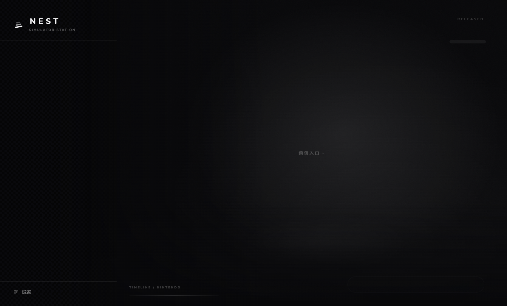
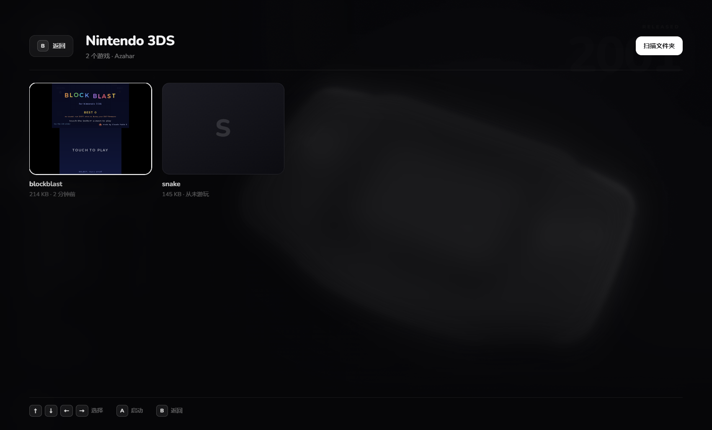
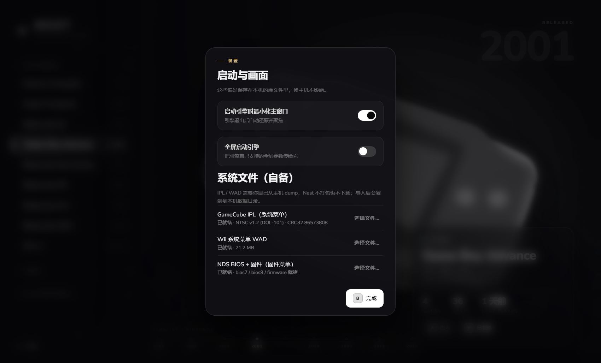
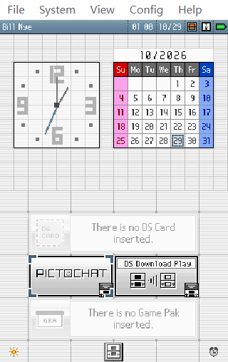

# Nest

**一台组装起来的虚拟主机。** 把各世代主机的照片、游戏库、模拟器、存档和手柄收进一个 Electron 外壳，
交互按“开一台主机”的逻辑走，而不是按“打开一个文件”的逻辑走。


> 当前：**0.3.2** —— Windows 桌面版 · 九台任天堂主机 · 五个内置引擎 · 免安装携带版

## 下载

直接下免安装版，解压双击即可用，不需要安装 Node 或任何依赖：

**[Nest-0.3.2-portable.zip](https://github.com/Parmetty/NEST-Emulator-Station/releases/download/v0.3.2/Nest-0.3.2-portable.zip)** · 234 MB · [Release 页面](https://github.com/Parmetty/NEST-Emulator-Station/releases/tag/v0.3.2)

```
SHA256  B5AE4AF8DDAC53CADACA1C8E493864FC3C23C65E0EBD0702594452422646AFA1
解压    598 MB / 2905 个文件
```

1. 解压到任意目录（可放 U 盘）
2. 双击 **`启动 Nest.bat`**（带便携数据模式：库/封面/日志/引擎配置都留在解压目录的 `data\` 里）
3. 点「扫描文件夹」指向你的 ROM 目录（之后每次启动会自动重扫）
4. 固件在 设置 →「系统文件（自备）」导入

> 无数字签名，首次运行 Windows 可能提示 SmartScreen：选「更多信息 → 仍要运行」。

## 现在能做什么

| 主机 | 引擎（内置） | 直读 | 系统菜单 |
|---|---|---|---|
| GBA | mGBA 0.10.5 | ✅ | — |
| FC | ares v148 | ✅ | — |
| SFC | ares v148 | ✅ | — |
| N64 | ares v148 | ✅ | — |
| NDS | melonDS 1.1 | ✅ | ✅ DS 固件菜单（需 BIOS/firmware） |
| NGC | Dolphin 2609a | ✅ | ✅ GameCube Menu（需 IPL） |
| Wii | Dolphin 2609a | 🟡 代码就绪，待镜像验证 | ✅ Wii Menu（需 WAD） |
| 3DS | Azahar 2126.2 | ✅ | ❌ 引擎不支持 HOME Menu |
| Wii U | — | 仅清单 | — |

其它能力：

- **主机墙**：9 台任天堂主机按发售年份排列，全屏照片 + 树状列表 + 信息卡；平台切换时年代标尺跟着换
- **游戏库 + 自动扫描**：添加过的文件夹会在启动时自动重扫，新 ROM 自动出现；支持 `.cia` 与磁盘头 magic 判定 GC/Wii
- **自动封面**：游戏运行期间由独立抓屏工具持续取帧，退出时存为封面（NDS/3DS 只截上屏）
- **键位面板**：mGBA / ares / Dolphin / Azahar / melonDS 五引擎键盘绑定可在 Nest 里改，保存立即生效；首次启动自动写默认布局，不覆盖你已有的自定义
- **固件中心**：GameCube IPL（CRC32 白名单）、Wii 系统菜单 WAD、NDS BIOS+固件，一键导入
- **便携模式**：库、封面、日志、引擎配置都留在程序目录，删 `data\` 即恢复出厂
- **运行中高亮 / 进入前确认 / 右键移除**（只删库记录，绝不动磁盘上的 ROM）

### 键位

| 主机族 | 默认键盘布局 |
|---|---|
| GBA / NDS / 3DS | 方向键 = 十字键，Space = A，J = B，Q/E = L/R，Enter = Start，Backspace = Select |
| FC / SFC / N64 | W/S/A/D = 十字键，J/K = A/B，U/I = X/Y（SFC），Q/E = L/R，Enter = Start，右 Shift = Select |
| NGC / Wii | Dolphin GCPad 键盘布局 |

细节见 [docs/KEYS-GBA.md](docs/KEYS-GBA.md)、[KEYS-DOLPHIN.md](docs/KEYS-DOLPHIN.md)、
[KEYS-3DS.md](docs/KEYS-3DS.md)、[KEYS-ARES.md](docs/KEYS-ARES.md)。



## 截图

| 游戏库 | 3DS 游戏库 |
|---|---|
|  |  |

| 固件中心 | NDS 固件菜单 |
|---|---|
|  |  |

## 从源码运行

需要 Windows 10/11 + Node.js 20+。

```bash
npm install
npm run build
npm run start          # 或双击 Nest.bat（自动构建 + 工作区数据目录）
```

`Nest-check.bat` 会依次跑：类型检查 → 单元测试 → 构建 → 窗口冒烟。

### 打便携包

```bash
npm run pack:dir       # dist/win-unpacked（免安装目录）
npm run pack           # 免安装目录 + NSIS 安装包（默认不用，见 DECISIONS D20）
```

打包前会自动执行 `tools/clean-engines.mjs`，清掉引擎配置里的本地路径与运行时状态。

## 测试

```bash
npm run typecheck
npm test               # 40 个用例：扫描/去重/清单/keymap/引擎配置写入/进程生命周期
npm run build
npm run smoke          # 窗口 + IPC + 渲染自检
```

## 架构

```
src/
  shared/            纯数据与契约（主机表、zod schema、IPC 通道名）
  main/              主进程：窗口、IPC、库、引擎清单、进程监管、扫描器
  main/controls/     各引擎的键盘绑定适配器（keymap + mgba/ares/dolphin/azahar/melonds）
  preload/           contextBridge 暴露的 window.nest
  renderer/          React：首页 + 游戏库覆盖层 + 设置面板
resources/engines/   五个便携引擎 + 清单（加主机 = 加一份 JSON）
resources/tools/     nest-capture / nest-input / nest-window / nest-menu / nest-pads
tools/               C# 助手源码、打包清理脚本、运行器
docs/                CHANGELOG / STATE / DECISIONS / PROGRESS / PLAN / KEYS-*
```

设计约定：

- **引擎是数据**：`resources/engines/<id>.json` 描述路径、参数、能力，加主机不改代码
- **进程外运行**：模拟器永远是子进程，崩溃不拖死 UI，退出有精确事件
- **IPC 全量校验**：渲染进程只拿到 `window.nest`，所有入参过 zod
- **不内置版权物**：没有 ROM / BIOS / NAND / 密钥

## 数据与隐私

数据目录默认 `%APPDATA%\Nest`；用启动脚本时改为程序目录下 `data\`：

```
library.json     游戏库、主机状态、设置
settings.controls  键位覆盖（每引擎）
scanRoots         自动扫描的文件夹列表
covers/           自动封面
shots/            抓屏中间帧（退出后清理）
nest.log          主进程日志
dolphin/          GC IPL、Wii 菜单 WAD、NAND
melonds/          NDS BIOS
azahar/           3DS 配置与 NAND
```

没有遥测，除引擎官网外不联网。

## 已知限制

- **封面可能截到黑帧**：目前取退出前最后一帧；全黑过场的游戏可能拿到黑封面（COV-2，已评审待实现）
- **Wii 直读**代码就绪但尚无真实镜像验证；Wii U 仅清单（Cemu 未随包）
- **3DS 无系统菜单**（Azahar 不支持 HOME Menu）
- **NGC 系统菜单**为 GUI 自动化（`File → Boot firmware` 类似路径），需要有效 IPL，Qt 菜单展开瞬间会短暂影响输入
- **没有数字签名**：首次运行 SmartScreen 提示；个别环境需 `--no-sandbox`（启动脚本已带）
- **Dolphin 键位面板**只覆盖 GCPad 主键位，select/Z/C-Stick 等扩展动作暂未映射

## 路线图

| 阶段 | 内容 | 状态 |
| --- | --- | --- |
| P0–P2 | 骨架、IPC、引擎清单、扫描器、GBA/FC/SFC/N64 闭环 | ✅ |
| P3 | Dolphin（NGC/Wii 直读 + 系统菜单）、3DS（Azahar）、NDS（melonDS） | ✅ |
| P4 | Wii U（Cemu、MLC/密钥） | 未开始 |
| P5 | 封面质量、自动构建脚本、安装包（按需） | 进行中 |

更细的状态见 [docs/CHANGELOG.md](docs/CHANGELOG.md)、[docs/STATE.md](docs/STATE.md)、[docs/PROGRESS.md](docs/PROGRESS.md)。

## 法律

- 本仓库**不含**任何 ROM、BIOS、NAND 或密钥；只启动你提供的模拟器、扫描你已有的文件。
- 内置引擎与许可证：mGBA（MPL 2.0）、ares（ISC）、Dolphin（GPLv2+）、Azahar（GPLv3）、melonDS（GPLv3）、SDL3（Zlib）。
- 主机照片来自 Wikimedia Commons 的公有领域素材（Evan-Amos），已做裁切/去色/模糊处理；可被用户替换。
- 各主机商标归各自权利人所有，本项目与任天堂、微软、索尼无关联。

完整第三方清单见 [THIRD-PARTY-NOTICES.md](THIRD-PARTY-NOTICES.md)，引擎配置与键位细节见 `docs/`。

## 许可

**MIT**（见 [LICENSE](LICENSE)）。内置引擎各自的许可证不受 MIT 影响，见
[THIRD-PARTY-NOTICES.md](THIRD-PARTY-NOTICES.md)。
