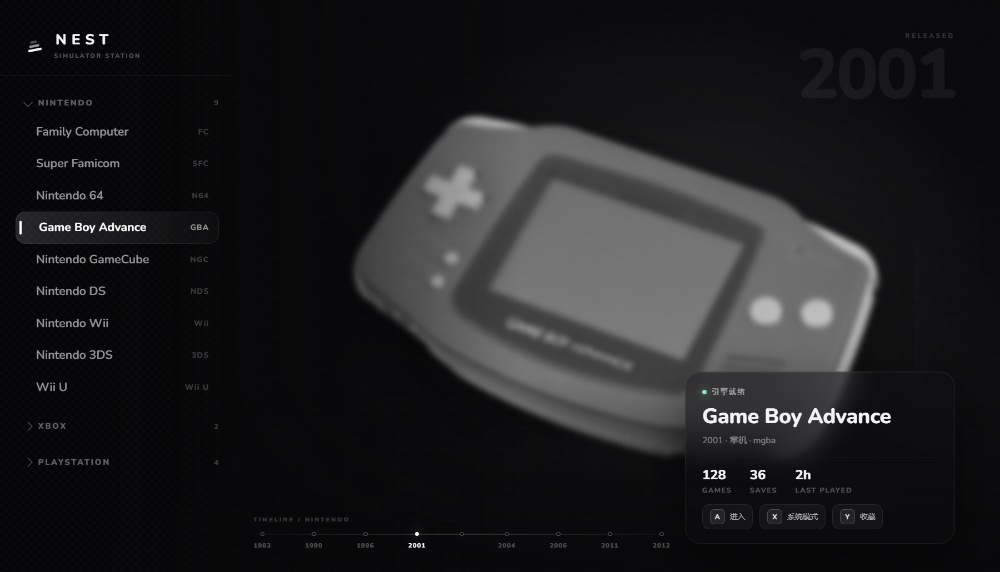
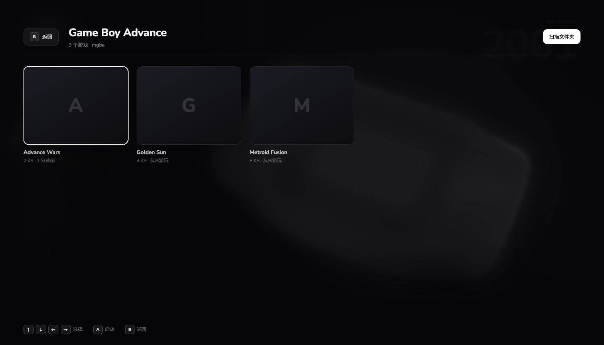

# Nest

**一台组装起来的虚拟主机。** 把各世代主机的照片、游戏库、模拟器、存档和手柄收进一个 Electron 外壳，
交互按“开一台主机”的逻辑走，而不是按“打开一个文件”的逻辑走。



> 当前：**beta 0.2** —— Windows 桌面版，GBA 已经可以从扫描到游玩跑通。

## 现在能做什么

- **主机墙**：9 台任天堂主机按发售年份排列，全屏照片 + 树状列表 + 信息卡；平台（Nintendo / Xbox / PlayStation）切换时年代标尺跟着换
- **游戏库**：扫描文件夹 → 按内容哈希去重入库 → 卡片墙 → 方向键/鼠标导航 → 启动
- **真的能玩**：GBA 用内置的 mGBA 启动，退出后回到 Nest，最近游玩时间自动更新
- **自动封面**：游戏运行期间由独立抓屏工具持续取帧，退出时把最后一帧存为封面
- **右键移除**：从库中移除记录，绝不动磁盘上的 ROM
- **运行中高亮**：主机行呼吸点、信息卡「运行中 ×N」、卡片角标；切窗口不会掉，支持多开
- **进入前确认**：`注意！您即将启动 XXX`，鼠标滑过不会误启动



## 要求

- Windows 10 / 11
- Node.js 20+（开发用）
- 想重新编译抓屏工具的话，需要 .NET Framework 4.x 自带的 `csc.exe`（Windows 自带）

## 快速开始

```bash
npm install
npm run build
npm run start
```

或者直接双击 **`Nest.bat`**：它会检查依赖、必要时构建、带上工作区数据目录并启动窗口。
双击 **`Nest-check.bat`** 可以先跑一遍自检（类型检查 → 单元测试 → 构建 → 窗口冒烟）。

导入游戏：左侧选主机 → `A` 进入 → 右上角「扫描文件夹」→ 选装 ROM 的目录 → 卡片出现 → `A` 启动。

## 数据与隐私

所有数据都在本机的 `userData` 目录（默认 `%APPDATA%\nest`，或用 `--user-data-dir` 指定）：

```
library.json     主机状态、游戏库、设置
covers/          自动生成的封面
shots/           抓屏工具的中间帧（退出后清理）
nest.log         主进程日志
```

没有遥测，不联网（除了你主动打开引擎官网）。

## 架构

```
src/
  shared/       纯数据与契约（主目录、zod schema、IPC 通道名）
  main/         主进程：窗口、IPC、库、引擎清单、进程监管、扫描器
  preload/      contextBridge 暴露的 window.nest
  renderer/     React：首页 + 游戏库覆盖层
resources/engines/*.json   引擎清单（加一台主机 = 加一份 JSON）
resources/tools/nest-capture.exe   独立抓屏工具
tools/capture/NestCapture.cs       它的源码
docs/          PLAN / DECISIONS / STATE 与冻结的视觉基准
```

设计约定：

- **引擎是数据**：`resources/engines/<id>.json` 描述路径、参数、能力，加主机不改代码
- **进程外运行**：模拟器永远是子进程，崩溃不拖死 UI，退出有精确事件
- **IPC 全量校验**：渲染进程只拿到 `window.nest`，所有入参过 zod
- **不内置版权物**：没有 ROM / BIOS / NAND / 密钥

## 抓屏工具

`resources/tools/nest-capture.exe`（7.6 KB）：

```
nest-capture.exe --pid <pid> --out <dir> [--interval 5000] [--max 60]
                 [--aspect 1.5] [--once] [--log <file>]
```

抓目标进程窗口的**客户区**（对模拟器就是画面本身），`--aspect` 按主机屏幕比例从底部裁掉 Qt 菜单栏。
重新编译：`npm run build:capture`。

## 测试

```bash
npm run typecheck
npm test          # 15 个用例：扫描/去重/清单/参数/进程生命周期
npm run build
npm run smoke     # 窗口 + IPC + 渲染自检
```

## 路线图

| 阶段 | 内容 | 状态 |
| --- | --- | --- |
| P0 | 骨架、IPC、引擎清单、进程监管 | ✅ |
| P1 | 扫描器 + GBA 全链路 + 内置 mGBA | ✅ |
| P1.2 | 封面、右键移除、运行中高亮 | ✅ |
| P2 | FC / SFC / N64 闭环、固件校验、每游戏设置、存档备份 | 下一步 |
| P3 | Dolphin、NAND 导入、Wii Menu | |
| P4 | Cemu、MLC/keys、Wii U Menu | |
| P5 | 手柄导航、滤镜、首次启动向导、安装包 | |

细节在 [docs/PLAN.md](docs/PLAN.md)，决策记录在 [docs/DECISIONS.md](docs/DECISIONS.md)。

## 已知限制

- 只有 GBA 接了完整链路；其余主机是引擎清单 + 界面，还没接扫描/启动
- 系统模式（Wii Menu / Wii U Menu / NGC IPL）还没在真机上验证
- 没有安装包，目前从源码运行
- 抓屏要求窗口可见；最小化时不抓

## 法律

- 本仓库**不含**任何 ROM、BIOS、NAND 或密钥；只启动你提供的模拟器、扫描你已有的文件。
- 内置的 mGBA 0.10.5 以 MPL 2.0 分发，许可证随包附带（`resources/engines/mgba/LICENSE.txt`）。
- 主机照片来自 Wikimedia Commons 的公有领域素材（Evan-Amos），已做裁切/去色/模糊处理；可被用户替换。
- 各主机商标归各自权利人所有，本项目与任天堂、微软、索尼无关联。

完整的第三方清单见 [THIRD-PARTY-NOTICES.md](THIRD-PARTY-NOTICES.md)。

## 许可

**MIT**（见 [LICENSE](LICENSE)）。你可以自由使用、修改、分发，甚至商用，只要保留版权声明。
唯一需要注意的是：内置的 mGBA 是 **MPL 2.0**，它的条款不受 MIT 影响，见
[THIRD-PARTY-NOTICES.md](THIRD-PARTY-NOTICES.md)。


